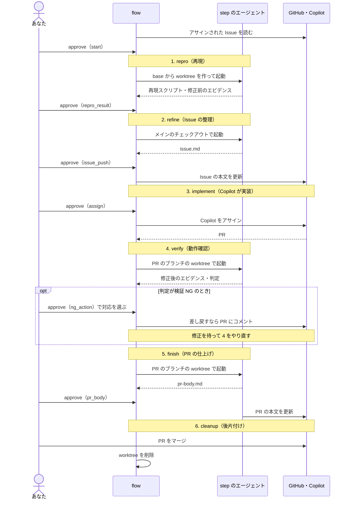

<div align="center">

# flow

**アサインされた Issue を、AI エージェントがマージまで運ぶ。人は承認するだけ。**

再現 → Issue の整理 → 実装（Copilot）→ 動作確認 → PR の仕上げ → 後片付け。<br>
各段階を [Herdr](https://herdr.dev/) 上のエージェントに任せて複数の Issue を並列に進め、要所だけ人の承認を待つオーケストレーター CLI です。

[](https://github.com/fox-taiga-nakano/flow/releases)
[](LICENSE)
[](https://nodejs.org/)

[特徴](#特徴) · [しくみ](#しくみ) · [インストール](#インストール) · [クイックスタート](#クイックスタート) · [コマンド](#コマンド) · [設定](#設定) · [ドキュメント](#ドキュメント)
</div>

---

```console
$ flow init
✔ 作成: .flow/WORKFLOW.md（vars: example-org/example-app）
✔ 作成: .herdr/worktree.json
✔ 作成: .agents/skills/flow-repro
✔ 作成: .claude/skills/flow-repro → .agents/skills/flow-repro
...
$ flow validate
✔ WORKFLOW.md: valid
$ flow run
```

## 特徴

- **段階ごとに専任のエージェント** — Issue の段階に応じて、Herdr のペインで step ごとのエージェントを起動します。作業場所は Issue ごとの worktree に分かれるので、複数の Issue を並列に進められます
- **人は要所で承認するだけ** — 着手・Issue の更新・Copilot のアサイン・PR 本文の更新などは gate で止まり、`flow approve` を待ちます。どの gate を自動にするかは設定で選べます
- **修正前と修正後を同じ手順で比べる** — repro で作った再現スクリプトを、verify で PR のブランチに対して実行し直します。エビデンスとチェックの結果は、そのまま PR に載ります
- **止まっても安全に再開** — 状態・所有記録・ロックを `.flow/` に保存します。再試行・復旧・停止の対象は flow が所有するものだけで、人の作業には触れません
- **手順はプロジェクトのもの** — 段階・step・gate・プロンプトは `.flow/WORKFLOW.md` に書きます。flow 本体は、プロジェクト固有の名前や手順を持ちません
- **すぐに始められる** — `flow init` が設定のテンプレートと各 step のスキルを置きます。`flow run --dry-run` で、実際に動かす前に予定を確かめられます

## しくみ


図の上半分は構成の一例、下半分は 1 件の Issue がたどる流れです。

- **メイン** — あなたはメインの Claude Code に依頼と承認を伝えます。メインの Claude Code が `flow` を動かし、`flow` は GitHub の Issue・PR を読んで段階を進めます
- **worktree** — `flow` は Issue・PR ごとに worktree を作り、step を担当するエージェントを起動します。slot ごとに dev サーバーのポートが分かれるので、複数の Issue が並行して動きます
- **道具は差し替えられる** — Codex・playwright-cli・Google Drive は、各 step のスキルが使う道具の例です。プロジェクトに合わせてスキルを書き換えます

流れを step と gate（承認のポイント）で表すと、次のようになります。番号は図の 1〜6 に対応します。



`approve（…）` が gate です。`flow` は tick ごとに GitHub と各 Issue の状態を読み、次に進める step を決めます。gate が `manual` なら承認を待ち、`auto` ならそのまま進みます。verify・finish・cleanup の前にも gate（`verify_start`・`finish_start`・`cleanup`）がありますが、テンプレートの初期値が `auto` なので図では省いています。ほかの gate の初期値は `manual` です。

| step      | 動く場所                 | エージェント         | 作るもの                                           |
| --------- | ------------------------ | -------------------- | -------------------------------------------------- |
| repro     | base から作る worktree   | `flow-repro` スキル  | `repro.md`・`scripts/repro.sh`・修正前のエビデンス |
| refine    | メインのチェックアウト   | `flow-refine` スキル | `issue.md`（承認後に Issue の本文へ）              |
| implement | GitHub                   | Copilot              | PR                                                 |
| verify    | PR のブランチの worktree | `flow-verify` スキル | 修正後のエビデンス、検証済か検証 NG の判定         |
| finish    | PR のブランチの worktree | `flow-finish` スキル | `pr-body.md`（承認後に PR の本文へ）               |
| cleanup   | —                        | —                    | worktree の削除                                    |

## インストール

### 必要なもの

- Linux または macOS、Bash
- [mise](https://mise.jdx.dev/)、[Herdr](https://herdr.dev/)
- Node.js 24 以上
- [GitHub CLI](https://cli.github.com/)（`gh`）と、対象リポジトリにアクセスできる認証
- 同梱の `flow issue` / `flow wt` を使う場合：git、`jq`、`ss`（iproute2）、`column`

### mise で入れる

対象プロジェクトの `mise.toml` に追加します。`version` は [Releases](https://github.com/fox-taiga-nakano/flow/releases) の最新に合わせてください。

```toml
[tools]
"github:fox-taiga-nakano/flow" = { version = "0.1.0", asset_pattern = "flow-universal.tar.gz", bin_path = "bin" }

[tasks.flow]
tools.node = "24.22.1"
raw_args = true
run = "flow"
```

```sh
mise install
mise run flow --help
```

アーカイブには CLI・実行時の依存・テンプレート・スキル・同梱コマンドが入っています（Node.js は別に必要です）。以下では `mise run flow` を `flow` と書きます。

## クイックスタート

**1. テンプレートを置く** — 対象プロジェクトのメインのチェックアウトで実行します。既にあるファイルは上書きしません。

```sh
flow init
```

| 置かれるもの            | 内容                                                 |
| ----------------------- | ---------------------------------------------------- |
| `.flow/WORKFLOW.md`     | 全 step の構成。`vars` は git の origin から埋めます |
| `.herdr/worktree.json`  | worktree にコピーするファイル・ポート・フック        |
| `.agents/skills/flow-*` | 各 step のスキル（`.claude/skills/` からリンク）     |

**2. プロジェクトに合わせる** — `init` が表示する「次の作業」に従います。

- `.flow/WORKFLOW.md` の `base.resolve`（PR のマージ先の base を出力するコマンド）
- 環境変数 `ISSUE_DIR`（Issue ごとのディレクトリの置き場所。例：`mise.toml` の `[env]`）
- `.gitignore` に `/.flow/state/`・`/.flow/run/`・`/.flow/logs/`
- 各スキルの「プロジェクトに合わせて書き換える」節（開発サーバーの起動、画面の操作、テスト）

**3. 確かめてから動かす** — Herdr のセッションの中で実行します。

```sh
flow validate        # 設定を検証
flow tick --dry-run  # 次の tick の予定を表示（読み取りだけで、変更はしない）
flow run             # tick を繰り返す（Ctrl+C で、実行中の tick を終えてから止まる）
```

> [!TIP]
> 同梱の `flow-operator` スキルを使うと、メインのエージェント（[しくみ](#しくみ)の図の「Claude Code メイン」）が `flow run` を横のペインで動かし、承認待ちや質問をまとめて伝えます。複数の Issue を並列に進めていても、見るのは 1 つの会話だけで済みます。

## コマンド

### 見る

| コマンド                 | 内容                                                          |
| ------------------------ | ------------------------------------------------------------- |
| `flow status [issue]`    | 状態と承認待ちの一覧。Issue を指定すると詳細（`--json` も可） |
| `flow logs [issue] [-f]` | イベントログ                                                  |
| `flow watch`             | 承認待ち・エラーを待ち、JSON で返す（運用スキル向け）         |
| `flow open <issue>`      | agent のタブへ移動                                            |

### 進める

| コマンド                      | 内容                                                        |
| ----------------------------- | ----------------------------------------------------------- |
| `flow run` / `flow tick`      | tick を繰り返す／1 回だけ実行する（`--dry-run` で予定だけ） |
| `flow approve <issue> [gate]` | gate を承認（`--choice` で選択肢を指定）                    |
| `flow answer <issue> "回答"`  | agent の質問に回答                                          |
| `flow reject <issue> [gate]`  | 対象外にして止める                                          |
| `flow retry <issue>`          | 試行回数を戻して再開                                        |
| `flow stop <issue>`           | flow が所有するエージェントを止める                         |

### 準備・補助

| コマンド                                                         | 内容                                 |
| ---------------------------------------------------------------- | ------------------------------------ |
| `flow init`                                                      | テンプレートとスキルを置く           |
| `flow validate`                                                  | `WORKFLOW.md` を検証                 |
| `flow issue <dir\|mark\|push\|status>`                           | Issue ごとのディレクトリと段階を扱う |
| `flow wt <create\|list\|ports\|sync\|remove\|stop\|agent\|hook>` | Herdr の worktree を扱う             |
| `flow lock <acquire\|release\|list>`                             | 資源のロック                         |

すべてのコマンドに `--help` があり、引数・選択肢・関わる gate を確かめられます。

```sh
flow approve 123 base_changed --choice keep   # base の変更を確認し、固定した base を維持する
```

## 設定

手順はすべて対象プロジェクトの `.flow/WORKFLOW.md` に書きます。YAML front matter に段階・step・gate を、本文に step ごとのプロンプトを書きます。

```yaml
---
gates:
  start: manual        # 着手は人が決める
  verify_start: auto   # PR ができたら自動で動作確認
steps:
  repro:
    when_stage: 未着手
    gate_before: start
    workspace: { from_base: "origin/{base}", branch: "flow/repro-{issue}" }
    agent: { kind: claude, name: "flow-repro-{issue}" }
    done_when: { files: [repro.md, scripts/repro.sh, evidence/before/checks.tsv] }
    gate_after: repro_result
    on_ok: { set_stage: 再現済 }
---

## prompt: repro

`.claude/skills/flow-repro/SKILL.md` に従い、Issue #{issue.number} を再現してください。
```

- 全体の例は [templates/WORKFLOW.md](templates/WORKFLOW.md)、各項目は [仕様書](docs/spec.md) にあります
- Issue のディレクトリと worktree は同梱の `flow issue` / `flow wt` で扱います。別の方法で管理するなら、`WORKFLOW.md` のコマンドを差し替えます
- worktree の設定 `.herdr/worktree.json` は flow 以外のツールとも共有できます（[templates/worktree.json](templates/worktree.json)）

<details>
<summary><b>状態とログの置き場所</b></summary>

| 場所                         | 内容                                                   | 扱い                   |
| ---------------------------- | ------------------------------------------------------ | ---------------------- |
| `.flow/WORKFLOW.md`          | プロジェクトの設定                                     | リポジトリで管理       |
| `.flow/state/`               | 所有記録、ロック台帳、Issue 一覧、最後に正常だった設定 | 消さない               |
| `.flow/run/`                 | 実行中の PID・ロック、dry-run の一時データ             | 停止中なら整理してよい |
| `.flow/logs/`                | 日付ごとのイベントログ                                 | 古いものは整理してよい |
| `<Issue ディレクトリ>/flow/` | Issue ごとの状態とエージェントの結果                   | 消さない               |

flow は、自分が所有すると記録した worktree・エージェントだけを操作します。

</details>

<details>
<summary><b>更新するとき</b></summary>

1. `flow run` を止め、実行中の tick が終わるのを待ちます
2. `.flow/state/` と Issue ごとの `flow/` は残したまま、`mise.toml` の `version` を上げて `mise install` します
3. `flow validate` と `flow tick --dry-run` で確かめてから再開します

旧版と新版を同時に動かさないでください。

</details>

## ドキュメント

|                                     |                                        |
| ----------------------------------- | -------------------------------------- |
| [仕様書](docs/spec.md)              | 設定の形式と動作の詳細                 |
| [導入時の設定](docs/integration.md) | 必須の項目と、設定の置き場所の考え方   |
| [ガイド](docs/guide.md)             | Issue のアサインからマージまでの運用例 |

## 開発

<details>
<summary>ビルド・テスト・リリース</summary>

`.node-version` の Node.js と、`package.json` の `packageManager` の pnpm を使います。

```sh
pnpm install --frozen-lockfile
pnpm build  # CLI と docs をビルド
pnpm check && pnpm typecheck
pnpm test   # CLI とテスト用フィクスチャをビルドしてから実行
```

CLI のみをビルドする場合は `pnpm build:cli` を使います。

リリースは、`package.json` のバージョンに一致する `v` 付きのタグを push します。GitHub Actions がテストとアーカイブの動作確認をしてから、Release に `flow-universal.tar.gz` を添付します。ローカルでは `pnpm build && ./scripts/package-release.sh` でアーカイブを作れます。

</details>

## ライセンス

[MIT](LICENSE)
