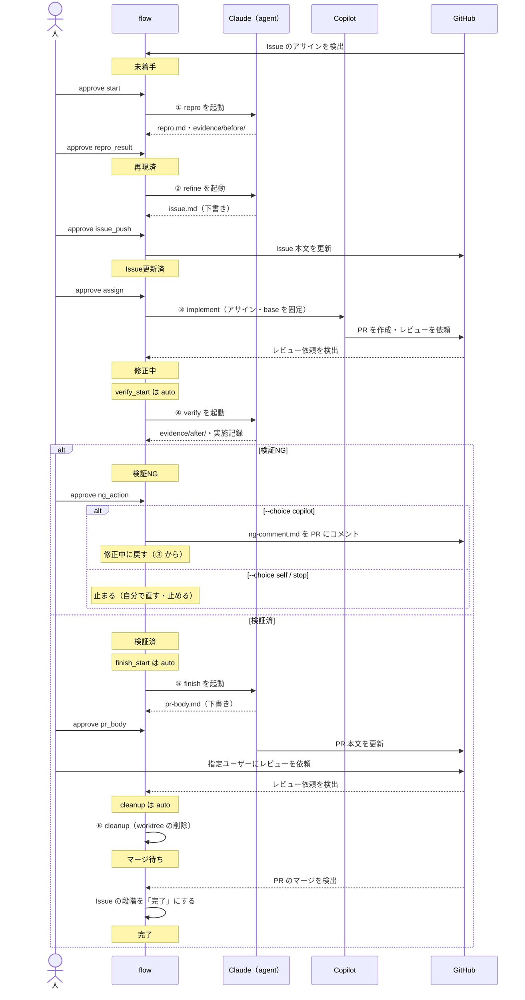

# flow の使い方：Issue のアサインからマージまで

Issue が自分にアサインされてから、レビュー依頼時に worktree を片付け、PR のマージで完了するまでの流れ。
設定は対象リポジトリの `.flow/WORKFLOW.md`、仕様は [仕様書](spec.md)。

> このガイドは、[導入時の設定](integration.md) の example-app での使用例に沿った運用例です。
> 次のものは example-app の設定で、flow には組み込まれていません。利用先では、`WORKFLOW.md` と手元のツールに合わせて読み替えてください。
>
> - 段階の名前（未着手・再現済・Issue更新済・修正中・検証済・検証NG・完了・対象外）と、Issue ディレクトリ `.dev/issues`
> - スキル（`issue-refine`・`pr-verify`・`pr-finish`）と mise タスク（`mise pw:repro` など）
> - 成果物（`repro.md`・`scripts/repro.sh`・`evidence/`）と base ブランチの決め方（`origin` の一番新しい `delivery/*`）

## 前提

- herdr の中で、リポジトリのルートのペインから実行する（エージェントは herdr のペインで起動される）
- `flow` はリポジトリの中なら直接実行できる（`mise flow` のときは、ヘルプは `mise flow -- --help`）
- 承認（gate）は WORKFLOW.md に従う。テンプレートでは `verify_start`・`finish_start`・`cleanup` は auto で自動的に進む。manual に変更すると承認待ちになる
- flow を動かす方法は 2 つ
  - 常駐：`flow run`（60 秒ごとに tick。Ctrl+C で止めても、動いているエージェントは止まらない）。表は同じ場所で書き換わり、最後の行に次の tick までの秒数が出る。前の tick から変わったセルは太字・下線。`approve`・`reject`・`retry`・`stop`・`answer` をすると、次の tick を待たずにすぐ tick する
  - 手で回す：`flow tick`（何をするかは `flow tick --dry-run` で先に見られる）

## 全体の流れ

`人->>flow: approve <gate>` は人の承認（`flow approve <番号> <gate>`）。段階（未着手・再現済 …）は `.dev/issues/<番号>-<段階>_<Issue番号>/` のディレクトリ名と同じ。

## 0. アサインされたら

1. GitHub で Issue が自分にアサインされる
2. 次の tick で flow が見つけ、`.dev/issues/7-未着手_<番号>/` を作る
3. `start` の承認待ちになる（`flow status` に出る）

ここで、flow で進める Issue かを決める。

- 進める：`flow approve <番号> start`
- flow で扱わない（手で進める・別の人が対応する）：`flow reject <番号> --reason "..."` → `0-対象外_<番号>` になり、以後 flow は扱わない

## 各 step の実行場所

worktree を使う step（repro・verify・finish）は、worktree の `agent` タブで `flow-<step>-<番号>` を1つ起動し、step の指示を直接送ります。質問には `flow answer <番号> "回答"` またはそのペインで答えます。メインで動く refine は、Issue ごとの `flow-<番号>` タブを使います。

## ① repro：再現（Claude）

| 項目         | 内容                                                                                                         |
| ------------ | ------------------------------------------------------------------------------------------------------------ |
| 動く場所     | その時点の最新の base（`origin` の一番新しい `delivery/*`）から作る worktree（ブランチ `flow/repro-<番号>`） |
| エージェント | `flow-repro-<番号>`                                                                                          |
| 作るもの     | `repro.md`、`scripts/repro.sh`、`evidence/before/`（スクリーンショットと `checks.tsv`）                      |
| 承認         | `repro_result`：再現できているかを確かめて `flow approve <番号> repro_result` → 段階が「再現済」             |

- 再現できなかった・仕様の確認が要るとき、エージェントは止まって通知する（`flow logs <番号>` で理由を見る）
- エージェントが質問してきたら、`flow status <番号>` で内容を確認し、`flow answer <番号> "回答"` で答える。`flow open <番号>` でペインに移動して答えることもできる

## ② refine：Issue 本文の下書き（Claude）

| 項目         | 内容                                                                                                                                                                                      |
| ------------ | ----------------------------------------------------------------------------------------------------------------------------------------------------------------------------------------- |
| 動く場所     | メインのチェックアウト（メインの workspace の `flow-<番号>` タブ）                                                                                                                        |
| エージェント | `flow-refine-<番号>`（issue-refine スキル）                                                                                                                                               |
| 作るもの     | `issue.md`（下書き）、`issue.orig.md`（元の本文）                                                                                                                                         |
| 承認         | `issue_push`：`issue.md` を確かめて（差分は `mise issue:push <番号> --diff`）`flow approve <番号> issue_push` → flow が `mise issue:push` で GitHub の本文を更新し、段階が「Issue更新済」 |

- Issue 更新後、repro の worktree を削除して slot を解放する。未コミット・未 push の変更がある場合は通知して残し、cleanup で再度試みる。

## ③ implement：Copilot での実装

| 項目            | 内容                                                                                                                    |
| --------------- | ----------------------------------------------------------------------------------------------------------------------- |
| 承認            | `assign`：アサインの本文と base（`.flow/state/previews/assignment-<番号>.json`）を確かめて `flow approve <番号> assign` |
| flow がすること | REST API で Copilot をアサインし、**その時点の最新の base** を渡す。この base を、その Issue の base として固定する     |
| 完了            | Copilot がレビューを依頼してきたら完了とみなし、段階が「修正中」                                                        |

- 自分で Copilot をアサインした場合も、Copilot の PR が見つかれば、そのまま完了待ちになる
- 週が変わって base が新しくなった、または PR の base が固定した base と違うときは `base_changed` で止まる
  - そのまま：`flow approve <番号> base_changed --choice keep`
  - PR の base を付け替える：`flow approve <番号> base_changed --choice retarget`

## ④ verify：動作確認（Claude）

| 項目         | 内容                                                                                        |
| ------------ | ------------------------------------------------------------------------------------------- |
| 承認         | `verify_start`：auto なら PR の検出後に開始。manual なら `flow approve <番号> verify_start` |
| 動く場所     | PR のブランチの worktree                                                                    |
| エージェント | `flow-verify-<番号>`（pr-verify スキルの worktree 側）                                      |
| 作るもの     | `evidence/after/`（`mise pw:repro <番号> after` の結果）、repro.md の実施記録               |
| 結果         | 段階が「検証済」または「検証NG」                                                            |

- DB リセットが要るときは、agent が理由と snapshot / seed の指定を result.json の `db_reset` に書いて止まる。flow 本体が、agent が停止していることと worktree の所有を確認し、DB の exclusive ロックを取って dev を停止・リセットする。ほかの検証が DB を使っている間は次の tick まで待つ。リセット不要の検証では実行しない
- 成功したら shared ロックへ戻し、同じ agent・同じ試行で再開する。失敗・中断で実行結果が不明なときは `operation_recovery` に止まり、検証を再開しない。勝手な再実行や seed への切り替えもしない
- `gates.db_reset: auto` なら追加のユーザー承認は不要。manual に変更すると `flow approve <番号> db_reset` が必要。Claude の安全設定は変更しない
- 検証NG のときは `ng_action` で止まる。`evidence/after/` と NG の内容を見て選ぶ
  - Copilot に直させる：`flow approve <番号> ng_action --choice copilot`（`ng-comment.md` を PR にコメントし、段階を「修正中」に戻す）
  - 自分で直す：`--choice self`（flow は止まる）
  - 止める：`--choice stop`

## ⑤ finish：PR 本文の更新（Claude）

| 項目         | 内容                                                                                                                             |
| ------------ | -------------------------------------------------------------------------------------------------------------------------------- |
| 承認         | `finish_start`：auto なら自動開始。manual なら `flow approve <番号> finish_start`                                                |
| 動く場所     | PR のブランチの worktree                                                                                                         |
| エージェント | `flow-finish-<番号>`（pr-finish スキルの A）                                                                                     |
| 作るもの     | `pr-body.md`（PR 本文の下書き。「動作確認結果」とエビデンスの画像）                                                              |
| 承認         | `pr_body`：`pr-body.md` と載せる画像を確かめて `flow approve <番号> pr_body` → エージェントが `gh pr edit --attach` で PR を更新 |

- すでに PR 本文を更新した Issue を飛ばすには、`gates.finish_start: manual` に設定し、`finish_start` で `flow approve <番号> finish_start --choice skip` にする（agent を起動せず finish を完了にする。PR・Issue は変えない）

## ⑥ cleanup：後片付け

| 項目            | 内容                                                                                                                |
| --------------- | ------------------------------------------------------------------------------------------------------------------- |
| きっかけ        | open PR のレビュー依頼先に、`steps.cleanup.when_pr_review_requested` に設定した GitHub ユーザーが1人以上いる        |
| 承認            | `cleanup`：auto なら自動実行。manual なら `flow approve <番号> cleanup`                                             |
| flow がすること | flow が作った・引き継いだ worktree を削除する（コミットしていない変更や push していないコミットがあれば削除しない） |
| worktree を残す | manual のとき `flow approve <番号> cleanup --choice keep`：worktree は消さず、flow の記録と slot のロックだけ外す   |

- cleanup と対象外では Issue の `flow-<番号>` タブを閉じる。人がペインを追加している場合は閉じずに通知する。
- Issue の段階は、関連 PR のマージを検出したときに「完了」に更新する。
- flow の外で開いた worktree（`mise wt` など）も、Issue の open PR のブランチか `flow/repro-<番号>` なら、`gates.adopt_workspace: auto` のとき次の tick で flow が引き継ぐ（記録と slot のロック。manual なら step の開始時に承認を求める）。flow の外で worktree を消したときも、次の tick で記録とロックを外す

## 保留：「保留」ラベル

- GitHub の Issue に「保留」ラベルを付けると、flow は**今の step が終わるのを待ってから**段階を「保留」（`8-保留_<番号>`）にして止める。動いているエージェントや Copilot は止めない。開始の承認待ちのときはすぐ保留になる
- ラベルを外すと、次の tick で保留の前の段階に戻して再開する（開始の承認は改めて求める）
- 保留中に `flow reject` すると対象外になり、`flow retry` で保留の前の段階に戻る

## 困ったとき

| 状況                                                                         | やること                                                                                                                   |
| ---------------------------------------------------------------------------- | -------------------------------------------------------------------------------------------------------------------------- |
| 今どうなっているか知りたい                                                   | `flow status`（一覧）、`flow status <番号>`（詳細）、`flow logs <番号>`（経緯）                                            |
| flow の外で段階が先に進んだ                                                  | `flow stop <番号>` → `flow retry <番号>` → 次の tick で今の段階から続く。段階を書き換える承認（`issue_push` など）はしない |
| 失敗してリトライの上限に達した（`failed`）                                   | `flow logs <番号>` で原因を見て、直したら `flow retry <番号>`                                                              |
| 起動・コマンドの結果が分からない（`launch_recovery` / `operation_recovery`） | ペインや GitHub で実際の結果を確かめ、済んでいたら `--choice applied`、やり直すなら `--choice retry`                       |
| 人が作った worktree を使おうとして止まった（`adopt_workspace`）              | flow に任せてよければ `flow approve <番号> adopt_workspace`                                                                |
| エージェントを止めたい                                                       | `flow stop <番号>`（flow が起動したエージェントだけ。worktree は消さない）                                                 |
| ロックを見たい                                                               | `flow lock list`                                                                                                           |

## 気をつけること

- **エージェントは flow の手順の範囲でしか動かない**。起動時に `## prompt: guard` をシステムプロンプトに入れているので、ペインで手順に無いこと（段階の変更・コミット・push・Issue や PR の更新など）を頼んでも断る。進めるときは `flow approve` などの flow の操作を使う
- **flow の外で同じ Issue を進めない**。手で進めると flow の記録とずれる。手で進めるなら、先に `flow reject` で外す
- **最初は 1 件ずつ進める**。プロジェクトの設定や外部サービス（Copilot のアサイン API など）が想定どおり動くことを確かめてから並列にする
- **DB リセットは必要な場合だけ flow 本体が自動実行する**。手で DB を使う作業と重ねない。失敗時は `operation_recovery` の実行状況を確認してから復旧する
- **ブラウザは resize しない**（1280x720 のまま）
